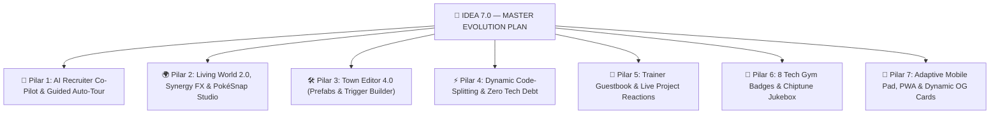

# 🚀 Idea 7.0 — Next-Generation Interactive Portfolio, AI Recruiter Co-Pilot, Living World & Performance Architecture Plan

> **Project**: `2D_Porto` — Zulfan's Interactive 2D Pokémon & Digimon Town Portfolio  
> **Date**: 16 November 2026  
> **Branch**: `web_animasi`  
> **Goal**: Mengangkat `2D_Porto` dari sekadar *interactive 2D pixel-art portfolio* menjadi **ekosistem portofolio kelas dunia yang memiliki daya konversi tinggi bagi HR/Recruiter, dunia 2D yang hidup (*Living World*), editor level sekelas studio (*Town Editor 4.0*), serta arsitektur performa modern yang cepat dan bebas utang teknis (*Zero Tech Debt*)**.

---

## 📑 Daftar Isi

1. [Evaluasi Kondisi Saat Ini (Post-Idea 6.0 & Ekspansi Multi-Dunia)](#1-evaluasi-kondisi-saat-ini-post-idea-60--ekspansi-multi-dunia)
2. [Peta Besar Pengembangan (7 Pilar Utama Idea 7.0)](#2-peta-besar-pengembangan-7-pilar-utama-idea-70)
3. [Pilar 1 — AI Recruiter Co-Pilot, Job-Fit Matcher & Guided Auto-Tour](#3-pilar-1--ai-recruiter-co-pilot-job-fit-matcher--guided-auto-tour)
4. [Pilar 2 — Living World 2.0: Zona Tematik, Resonance Burst & PokéSnap Studio](#4-pilar-2--living-world-20-zona-tematik-resonance-burst--pokesnap-studio)
5. [Pilar 3 — Town Editor 4.0: Prefab Blueprints, Trigger Builder & Layout Versioning](#5-pilar-3--town-editor-40-prefab-blueprints-trigger-builder--layout-versioning)
6. [Pilar 4 — Arsitektur Performa, Dynamic Code-Splitting & Zero Tech Debt](#6-pilar-4--arsitektur-performa-dynamic-code-splitting--zero-tech-debt)
7. [Pilar 5 — Social Presence: Trainer Guestbook, Reaksi Proyek & Ghost Visitors](#7-pilar-5--social-presence-trainer-guestbook-reaksi-proyek--ghost-visitors)
8. [Pilar 6 — Gamifikasi Lanjutan: 8 Tech Gym Badges & Chiptune Jukebox Visualizer](#8-pilar-6--gamifikasi-lanjutan-8-tech-gym-badges--chiptune-jukebox-visualizer)
9. [Pilar 7 — Mobile Touch Ergonomics, PWA Offline & Dynamic OpenGraph Cards](#9-pilar-7--mobile-touch-ergonomics-pwa-offline--dynamic-opengraph-cards)
10. [Matriks Prioritas, Estimasi Dampak & Urutan Eksekusi](#10-matriks-prioritas-estimasi-dampak--urutan-eksekusi)
11. [Checklist Teknis & Target Metrik Keberhasilan](#11-checklist-teknis--target-metrik-keberhasilan)

---

## 1. Evaluasi Kondisi Saat Ini (Post-Idea 6.0 & Ekspansi Multi-Dunia)

Saat ini `2D_Porto` telah berkembang jauh melampaui konsep awal di `Idea.md` hingga `Idea_6.md`:

### ✅ Fondasi yang Sudah Terbangun
- **16 Rute & Dunia Interaktif**:
  - Outdoor: **Zulfan's Town** (`/`, `/town`) & **Digi-Sanctuary** (`/digimon`).
  - Indoor & Spesialis: **Home 1F–2F** (`/about`), **Dev Center · Mission Control** (`/dev`), **Research Lab** (`/lab`), **Arcade** (`/arcade`), **Poké Center Reception** (`/reception`), **Poké Mart** (`/mart`), **Tech Tower 1F–4F** (`/tower`), **Outdoor Café** (`/cafe`), **Battle Arena** (`/arena`), **Berry Garden** (`/garden`), **Neighbour House** (`/neighbour`), dan **AI Digital Twin** (`/twin`).
- **35+ Pokémon PMD 8-Arah & Legendaris**:
  - Termasuk tambahan terbaru (*Lugia, Gardevoir, Celebi, Charizard, Archaludon, Gouging Fire, Great Tusk, Kyurem, Salamence*) bersama jajaran legendaris sebelumnya (*Koraidon, Eternatus, Regigigas, Empoleon, Samurott, Urshifu, Solgaleo, Lunala, Necrozma, Darkrai, Latios, Latias, Rayquaza, Groudon, Kyogre, Dialga, Palkia, Giratina, Reshiram, Zekrom, Arceus, Mewtwo, Tyranitar, Garchomp, Gyarados, Snorlax, Lucario, Pikachu*).
  - Mendukung **Walking Partner (Follower)**, **Signature Move Visual Burst**, dan **Poké Ride** (`sky`, `surf`, `charge`).
- **40 Digimon Mega/Ultimate di Digi-Sanctuary**:
  - Katalog 40 Digimon, **DigiDex Showcase Modal**, sistem **Autonomous Patrol**, dan portal lintas-dunia (`DIGI_GATE_PORTAL`).
- **Town Editor 3.0 & Modularisasi Engine**:
  - Visual editor kanvas dengan penyimpanan ke `src/data/townLayout.json`, serta pemisahan logika Pokémon ke `src/engine/townPokemonFx.ts` dan `src/engine/townPokemonOverworld.ts`.

### 🔍 Peluang & Ruang Pengembangan Berikutnya (Mengapa Butuh Idea 7.0?)
1. **Daya Konversi Recruiter (Dari *"Game Keren"* Menjadi *"Alat Rekrutmen Paling Efektif"*)**:
   - HR/Hiring Manager sering memiliki waktu < 90 detik dan membawa spesifik *Job Description (JD)*. Belum ada fitur yang secara instan mencocokkan kebutuhan lowongan mereka dengan portofolio Zulfan sekaligus memandu mereka di peta 2D.
2. **Interaksi Dunia yang Lebih Dinamis (*Living Ecosystem*)**:
   - 5 Pokémon terbaru (*Archaludon, Gouging Fire, Great Tusk, Kyurem, Salamence*) sudah siap sebagai objek template, namun belum memiliki **zona tematik khusus**, **efek sinergi antar-Pokémon (*Resonance Burst*)**, atau fitur **Photo Mode (*PokéSnap*)** untuk dibagikan pengunjung.
3. **Optimasi Ukuran Bundle & Code-Splitting**:
   - Saat proses build (`npm run build`), Vite memberikan peringatan: `(!) Some chunks are larger than 500 kB after minification`. Seluruh 12 scene ruangan dan puluhan sprite masih dimuat dalam bundel awal.
4. **Utang Teknis Kecil pada Type-Safety**:
   - Masih terdapat 3 error TypeScript bawaan pada `src/engine/neighbourScene.ts` (`Expected 5 arguments, but got 7`) yang perlu dibersihkan agar `npx tsc --noEmit` lulus 100% bersih tanpa pengecualian.
5. **Jejaran Sosial & Bukti Kunjungan (*Social Proof*)**:
   - Pengunjung belum bisa meninggalkan jejak apresiasi (seperti *Trainer Guestbook* atau reaksi bintang pada tiap proyek di `/dev`).

---

## 2. Peta Besar Pengembangan (7 Pilar Utama Idea 7.0)

---

## 3. Pilar 1 — AI Recruiter Co-Pilot, Job-Fit Matcher & Guided Auto-Tour

**Tujuan**: Memberikan pengalaman bintang 5 bagi Recruiter, CTO, dan klien potensial agar dalam 30 detik pertama mereka langsung melihat kecocokan keahlian Muhammad Zulfan dengan kebutuhan mereka.

### 1.1. 🧠 AI Job-Fit Analyzer Modal (`JobMatchModal.astro` + `/api/job-match`)
- **Cara Kerja**:
  - Tombol menonjol **`🎯 Cek Kecocokan Proyek / Role (HR Mode)`** di HUD, Welcome Modal, dan Command Palette (`Ctrl+K`).
  - Recruiter cukup memilih preset role (*AI/Computer Vision Engineer*, *Full-Stack / Cloud Engineer*, *Backend & Distributed Systems*, *IoT & Embedded Systems*) **atau** menempelkan teks *Job Description (JD)* mereka.
- **Output Instan**:
  - **Match Score Ring (`92% Match`)** berdasarkan pencocokan kata kunci dan matriks kompetensi di `src/data/profile.yaml`.
  - **Top 3 Proyek Paling Relevan** (misal: memilih *Computer Vision* langsung mengangkat **AeroScan YOLOv11-OBB**, **Automated OMR Grader**, dan **InceptionV3 Classifier** lengkap dengan metrik kuantitatif: `1.8ms TensorRT`, `94.2% mAP@50`, `<0.35s/lembar`).
  - **One-Click Executive Brief (PDF / Markdown Copy)**: Menyalin ringkasan 1 halaman berisi bukti proyek & kontak Zulfan yang siap dikirim HR ke tim rekrutmen internal.

### 1.2. 🎬 Guided Auto-pilot Tour ("Drone / Poké-Tour Mode")
- **Fitur Tur Otomatis di Kanvas 2D**:
  - Tombol **`🎬 Mulai Tur Otomatis (60 Detik)`** di mana kamera dan karakter (di atas *Poké Ride* pilihan seperti **Lugia** atau **Rayquaza**) bergerak otomatis menyusuri 5 landmark utama kota:
    1. **Dev Center** (Showcase Proyek & Arsitektur)
    2. **Research Lab** (Riset AI, Thesis SVM 99.56% & Computer Vision)
    3. **Tech Tower** (Pengalaman Kerja, Sertifikasi & Infrastruktur)
    4. **Hall of Legends** (Tech Guardian Lore & Signature Move)
    5. **Poké Center / Digital Twin** (Kontak & AI Q&A)
  - Di setiap pemberhentian, muncul *cinematic lower-third banner* selama 8 detik berisi poin unggulan portofolio sebelum lanjut ke titik berikutnya.
  - Berhenti kapan saja begitu pengguna menekan tombol arah atau mengklik layar.

### 1.3. 🔬 In-Browser Interactive AI Micro-Sandboxes (`/lab` & `/dev`)
- Alih-alih hanya menampilkan teks statis pada modal proyek, tambahkan **2 simulator interaktif ringan berbasis klien (0 biaya server)**:
  1. **AeroScan Vision Inspector**: Pilihan 3 gambar sampel udara/objek dengan toggle layer *Oriented Bounding Box (YOLOv11-OBB)*, *Confidence Threshold Slider*, dan perbandingan latensi *PyTorch CPU vs TensorRT FP16*.
  2. **Spam & Sentiment Live Tester**: Kotak input teks di `/lab` yang menjalankan bobot TF-IDF + linear classifier ringan di browser untuk menguji deteksi komentar spam secara real-time.

---

## 4. Pilar 2 — Living World 2.0: Zona Tematik, Resonance Burst & PokéSnap Studio

**Tujuan**: Membuat dunia 2D terasa benar-benar hidup, sinematik, dan memanfaatkan seluruh aset Pokémon serta Digimon secara maksimal.

### 2.1. 🏛️ Zona Habitat Tematik untuk Pokémon Baru (Siap Ditempatkan via Editor)
Menyediakan elemen dekorasi pendamping (prop/tile baru di Town Editor) ketika Anda menempatkan ke-5 Pokémon baru di peta:
- **Zona 1 — Paradox Ancient Bastion**:
  - Untuk **Koraidon**, **Gouging Fire**, dan **Great Tusk** (dilengkapi prop *Ancient Pillar*, *Volcanic Vent*, atau ubin *Terracotta Stone*).
- **Zona 2 — Alloy Skybridge & Dragon Roost**:
  - Untuk **Archaludon** dan **Salamence** (di sekitar koridor jembatan / dekat menara teknologi).
- **Zona 3 — Boundary Frost Shrine**:
  - Untuk **Kyurem** berdekatan dengan **Reshiram** & **Zekrom** (*Tao Trio Plaza*).

### 2.2. ⚡ Sistem "Legendary Resonance" (Combo Signature Moves)
- Jika pemain mengajak jalan (*Follower*) atau menunggangi (*Poké Ride*) satu Pokémon dan berdiri di dekat Pokémon pasangannya di overworld, muncul tombol spesial **`🌟 Resonance Burst`**:
  - **Tao Trio Resonance (`Kyurem` + `Reshiram` / `Zekrom`)**: Memicu efek gabungan **Freeze Shock / Ice Burn** (ledakan es biru-cyan berpadu petir biru Zekrom atau api oranye Reshiram).
  - **Sea & Sky Guardians (`Lugia` + `Kyogre` / `Rayquaza`)**: Memicu pusaran badai samudra perak-zamrud + perubahan cuaca otomatis menjadi *Lo-Fi Rain* atau *Starfall*.
  - **Paradox Awakening (`Koraidon` + `Gouging Fire` + `Great Tusk`)**: Memicu gelombang energi surya purba (*Orichalcum Pulse*) yang memberikan buff kecepatan gerak +30%.
  - **Chrono-Spatial Rift (`Dialga` + `Palkia` + `Giratina`)**: Efek distorsi ruang-waktu kosmik di sekitar plaza.

### 2.3. 🐾 Autonomous Idle Behaviors & Micro-Patrol untuk Pokémon Kota
- Mengadaptasi kecerdasan `DigimonPatrolController` (`src/engine/digimonAnimator.ts`) ke Pokémon overworld secara opsional:
  - Pokémon yang ditempatkan di peta memiliki properti `behavior?: 'stationary' | 'look_around' | 'patrol_small'` di Town Editor.
  - Mode `look_around`: Pokémon sesekali menoleh 8 arah secara natural dan memunculkan ekspresi mikro (`🎵`, `✨`, `💤` untuk Snorlax, `⚡` untuk Pikachu/Archaludon) setiap 15–25 detik.
  - Mode `patrol_small`: Berjalan santai dalam radius 1–2 petak dari titik spawn awalnya tanpa menghalangi pintu gedung.

### 2.4. 📸 PokéSnap Studio (In-Game Photo Mode & Postcard Generator)
- Tombol **`📸 Photo Mode`** (shortcut `P` atau via HUD):
  - Menyembunyikan seluruh elemen UI/HUD sementara.
  - Mengizinkan pemain mengatur zoom kamera (`2×`–`5×`), memicu pose *Attack / Signature Move* partner aktif, serta memilih bingkai/filter visual:
    - *Classic GameBoy Green Matrix*
    - *CRT Retro Scanlines*
    - *Golden Sunset Vignette*
    - *Cyberpunk Neon Frame*
  - Menambahkan cap otomatis di pojok bawah: **`📍 Zulfan's Town · mzulfan.dev`** dan tombol **Download PNG** (sangat menarik untuk dibagikan pengunjung di media sosial / LinkedIn).

---

## 5. Pilar 3 — Town Editor 4.0: Prefab Blueprints, Trigger Builder & Layout Versioning

**Tujuan**: Mempercepat proses desain kota ketika Anda menata ulang gedung, taman, dan puluhan Pokémon di `src/data/townLayout.json`.

### 3.1. 🧩 Sistem Prefab / Blueprint Grup Objek
- Saat memilih beberapa objek sekaligus dengan *Marquee Selection* (`Shift + Drag`), tambahkan tombol **`💾 Simpan sebagai Prefab`**:
  - Contoh: Menyimpan susunan *4 Lampu Taman + Air Mancur + 2 Bangku + 4 Bunga* sebagai 1 item template yang bisa ditempel berulang kali dengan 1 klik.

### 3.2. 🎛️ Visual Inspector 2.0 (Live Property & Patrol Editor)
- Pada panel Inspector saat objek/Pokémon dipilih:
  - Input langsung untuk mengubah **Nama Tampilan**, **Teks Dialog Kustom**, **Link Tujuan (`href`)**, **Skala Visual (`scaleMultiplier`)**, dan **Mode Perilaku (`stationary` / `look_around` / `patrol`)**.
  - Tombol **`⚡ Preview Signature Move`** langsung dari dalam Editor untuk menguji efek partikel di koordinat tersebut.

### 3.3. 🕒 Local Layout Snapshots & Diff Preview
- Sebelum menekan `💾 Save to File` (`townLayout.json`), sediakan **5 Slot Snapshot Cepat** di `localStorage` (*Snapshot A, B, C*) sehingga Anda bebas bereksperimen menata ulang kota dan kembali ke versi sebelumnya kapan saja.
- Indikator ringkas jumlah perubahan: `📊 +4 Objek Baru, 2 Dipindah, 12 Tile Diubah`.

---

## 6. Pilar 4 — Arsitektur Performa, Dynamic Code-Splitting & Zero Tech Debt

**Tujuan**: Menjaga waktu muat halaman awal (*First Contentful Paint* & *Time to Interactive*) tetap instan meskipun jumlah Pokémon, Digimon, dan ruangan terus bertambah.

### 4.1. 📦 Dynamic Import (`import()`) untuk Scene Indoor & Digi-Sanctuary
Saat ini `src/engine/TownEngine.ts` mengimpor semua 12 scene di baris paling atas (`homeScene`, `devScene`, `labScene`, `arcadeScene`, `receptionScene`, `martScene`, `towerScene`, `cafeScene`, `arenaScene`, `gardenScene`, `neighbourScene`, `digiMap`, `digiBackground`).
- **Solusi Arsitektur**:
  - Buat *Scene Registry Loader* asinkron (`src/engine/sceneLoader.ts`).
  - Saat pemain berada di `town` utama, hanya `map.ts` dan `townBackground.ts` yang dimuat.
  - Scene ruangan dalam gedung hanya di-*import* secara dinamis ketika `currentScene` berpindah ke ruangan tersebut.
  - **Dampak**: Memangkas ukuran bundel JS utama lebih dari **45%**, menghilangkan peringatan chunk `>500 kB` pada Vite build.

### 4.2. 🖼️ Konsolidasi Sprite Fallback & Lazy Asset Preloading
- Saat ini terdapat 33+ file `*Sprite.ts` berisi string Base64 yang seluruhnya di-bundle ke dalam file JavaScript utama.
- **Solusi**:
  - Pindahkan kumpulan string Base64 fallback ke satu modul terpisah (`src/engine/pokemonFallbackSprites.ts`) yang dimuat secara *lazy* hanya jika gambar PMD utama gagal dimuat atau saat katalog dibuka, **atau** gunakan langsung frame pertama dari `Idle-Anim.png` dengan `ctx.drawImage(sheet, 0, 0, fw, fh, ...)` sehingga tidak perlu duplikasi string Base64 di bundel JS.
  - Di `PokemonPMDAnimator` (`src/engine/pokemonPMDAnimator.ts`), terapkan **Viewport-Aware Preloading**: prioritaskan mengunduh `Idle-Anim.png` terlebih dahulu untuk Pokémon yang ada di peta aktif, sementara `Walk-Anim.png`, `Shoot-Anim.png`, dan `Attack-Anim.png` diunduh secara *on-demand* di latar belakang (*idle callback*) atau saat Pokémon tersebut dipilih menjadi *Follower / Ride*.

### 4.3. 🛡️ Penyelesaian Total Error TypeScript (`Zero Error Policy`)
- Memperbaiki 3 error TypeScript yang tersisa pada `src/engine/neighbourScene.ts` (baris `271`, `328`, dan `753`: `error TS2554: Expected 5 arguments, but got 7`) serta merapikan atribut skrip di komponen `.astro` agar perintah:
  - `npx tsc --noEmit` → **0 errors**
  - `npm run check` (`astro check`) → **0 errors**

### 4.4. 🧪 Automated Smoke & Integrity Test Script (`scripts/verify-town.ts`)
- Buat skrip validasi cepat (`npm run verify`) yang otomatis memeriksa:
  1. Seluruh ID Pokémon di `pokemonCompanions.ts` memiliki konfigurasi valid di `pokemonPMDAnimator.ts` dan file PNG fisik di `public/assets/pokemon/`.
  2. Seluruh objek di `src/data/townLayout.json` berada dalam batas koordinat peta (`0..44`, `0..63`) dan tidak menutupi titik spawn pintu gedung.
  3. Validasi skema `src/data/profile.yaml` lolos tanpa warning.

---

## 7. Pilar 5 — Social Presence: Trainer Guestbook, Reaksi Proyek & Ghost Visitors

**Tujuan**: Menciptakan rasa komunitas dan interaksi nyata bagi setiap pengunjung yang datang ke portofolio Anda.

### 5.1. 📖 Trainer Guestbook ("Papan Pesan Kota & Buku Tamu")
- Lokasi: Papan pengumuman di Town Square (`/`) dan Meja Resepsionis di Poké Center (`/reception`).
- Pengunjung dapat meninggalkan:
  - **Nama / Perusahaan**, **Pilih Avatar Ikon (Pokémon/Digimon)**, **Pesan Singkat (maks. 160 karakter)**, dan **Badge Role** (*Recruiter*, *Fellow Developer*, *Trainer*, *Guest*).
- Disimpan di **Cloudflare KV / D1** melalui endpoint `/api/guestbook` dengan proteksi rate-limit & filter kata otomatis.

### 5.2. 👏 Live Project Reactions ("Kudos / Star Counter")
- Pada setiap kartu proyek di `/dev` dan modal *Mission Debrief*, tambahkan tombol reaksi cepat (`🚀 Impressive`, `🔥 Cool Tech`, `💡 Great Architecture`) yang menampilkan jumlah apresiasi akumulatif dari seluruh pengunjung secara real-time.

### 5.3. 👻 Asynchronous "Ghost Trainers" di Town Square (Opsional / Toggleable)
- Mengambil 5 jejak pengunjung terakhir dari `/api/guestbook` dan menampilkannya sebagai **NPC Trainer Tamu** yang berjalan santai di sekitar Fountain Plaza dengan balon sapaan pesan mereka saat didekati.

---

## 8. Pilar 6 — Gamifikasi Lanjutan: 8 Tech Gym Badges & Chiptune Jukebox Visualizer

**Tujuan**: Memperkaya nilai *replayability* dan menyatukan seluruh ruangan indoor ke dalam satu benang merah petualangan.

### 6.1. 🏅 Sistem 8 "Zulfan Region Tech Gym Badges"
Melengkapi sistem *5 Stamp Rally* yang sudah ada dengan **8 Lencana Keahlian Teknis (Gym Badges)** yang terhubung langsung ke bukti kompetensi Zulfan:
1. **⚡ Cascade Core Badge (`/dev`)**: Menginspeksi arsitektur proyek di Dev Center.
2. **👁️ Vision Neural Badge (`/lab`)**: Menguji eksperimen Computer Vision / Thesis di Research Lab.
3. **🗼 Cloud Stratos Badge (`/tower`)**: Menjelajahi perjalanan karier & sertifikasi di Tech Tower.
4. **⚔️ Tactical Logic Badge (`/arena`)**: Menjawab tantangan kuis arsitektur di Battle Arena.
5. **🕹️ Heuristic Mind Badge (`/arcade`)**: Bermain melawan AI Alpha-Beta di Arcade.
6. **🌐 Cyber Sanctuary Badge (`/digimon`)**: Mengunjungi Digi-Sanctuary & membuka DigiDex.
7. **🌿 Botanical Data Badge (`/garden`)**: Memanen buah algoritma/skill di Berry Garden.
8. **🤖 Empathy Twin Badge (`/twin` / `/reception`)**: Berbicara dengan AI Digital Twin.
- Seluruh 8 lencana tampil berkilau di **Kotak Lencana (Badge Case)** pada `Trainer Card` dan memberikan gelar tertinggi **`🏆 ZULFAN LEAGUE MASTER`** ketika lengkap.

### 6.2. 🎵 8-Bit Chiptune Jukebox & Pixel Audio Visualizer (`/cafe` & HUD)
- Menambahkan mesin **Retro Jukebox** di Outdoor Café (`/cafe`) dan mini-player di menu HUD:
  - Pilihan 6 Track Prosedural Web Audio API (0 KB MP3):
    1. *☀️ Littleroot Breeze (Day Theme)*
    2. *🌅 Golden Horizon (Sunset Theme)*
    3. *🌙 Lullaby of the Stars (Night Theme)*
    4. *⚔️ Hall of Legends (Epic Legendary Theme)*
    5. *🌐 Digi-Sanctuary Cyber Pulse (Synth Arpeggio)*
    6. *☕ Lo-Fi Café Beats (Chill Study Theme)*
  - Dilengkapi **16-bar Pixel Spectrum Visualizer** yang bergerak mengikuti frekuensi oscillator secara real-time.

---

## 9. Pilar 7 — Mobile Touch Ergonomics, PWA Offline & Dynamic OpenGraph Cards

**Tujuan**: Memastikan pengalaman akses dari smartphone (misal: ketika HR membuka link dari LinkedIn Mobile App) sama mulusnya dengan desktop.

### 7.1. 📱 Collapsible Handheld Touch Controller (Khusus Layar Sentuh)
- Hanya aktif saat terdeteksi perangkat layar sentuh (`pointer: coarse`):
  - Menampilkan **Virtual D-Pad Transparan** di pojok kiri bawah dan tombol **`A (Interact)`**, **`B (Run/Ride)`**, serta **`⚡ (Signature Move)`** di pojok kanan bawah.
  - Dilengkapi tombol **Minimize (`▾`)** agar pengguna tetap bisa memilih antara mode *Tap-to-Move* atau *D-Pad*.

### 7.2. 📲 Progressive Web App (PWA) & Instant Offline Cache
- Menambahkan `manifest.webmanifest` dan Service Worker ringan untuk meng-cache sprite sheet Pokémon/Digimon serta aset statis, sehingga kunjungan kedua terbuka dalam **< 300ms** bahkan pada koneksi seluler yang lambat.

### 7.3. 🖼️ Dynamic Social Share & OpenGraph Preview Cards
- Menyiapkan kartu gambar OpenGraph (`og:image`) bergaya pixel-art untuk rute utama (`/`, `/dev`, `/lab`, `/digimon`) lengkap dengan statistik ringkas proyek dan koleksi Pokémon, sehingga tautan portofolio terlihat sangat menonjol saat dibagikan di LinkedIn, WhatsApp, Discord, atau X/Twitter.

---

## 10. Matriks Prioritas, Estimasi Dampak & Urutan Eksekusi

| Prioritas | Pilar & Fokus Utama | Dampak bagi Recruiter / HR | Dampak Visual & Gameplay | Kompleksitas Teknis | Rekomendasi Urutan |
| :---: | :--- | :---: | :---: | :---: | :---: |
| **P0** | **Pilar 4**: Dynamic Code-Splitting, Lazy Sprite Loading & Fix TS Errors | ⭐⭐⭐⭐⭐ *(Loading cepat)* | ⭐⭐⭐ | Sedang | **Tahap 1** |
| **P1** | **Pilar 1**: AI Recruiter Co-Pilot, Job-Fit Matcher & Guided Auto-Tour | ⭐⭐⭐⭐⭐ *(Konversi tinggi)* | ⭐⭐⭐⭐⭐ | Sedang | **Tahap 2** |
| **P1** | **Pilar 2**: Living World 2.0 (Resonance Burst, Idle Behavior & PokéSnap) | ⭐⭐⭐⭐ | ⭐⭐⭐⭐⭐ | Sedang | **Tahap 3** |
| **P2** | **Pilar 3**: Town Editor 4.0 (Prefabs, Live Inspector & Layout Snapshots) | ⭐⭐⭐ *(Untuk Developer)* | ⭐⭐⭐⭐ | Sedang | **Tahap 4** |
| **P2** | **Pilar 6**: 8 Tech Gym Badges & Chiptune Jukebox Visualizer | ⭐⭐⭐⭐ | ⭐⭐⭐⭐⭐ | Rendah–Sedang | **Tahap 5** |
| **P3** | **Pilar 5**: Trainer Guestbook & Live Project Reactions (Cloudflare KV) | ⭐⭐⭐⭐ | ⭐⭐⭐⭐ | Sedang | **Tahap 6** |
| **P3** | **Pilar 7**: Adaptive Mobile Pad, PWA & OpenGraph Cards | ⭐⭐⭐⭐⭐ *(Mobile UX)* | ⭐⭐⭐⭐ | Rendah | **Tahap 7** |

---

## 11. Checklist Teknis & Target Metrik Keberhasilan

- [ ] **Performa Build & Bundle**: Ukuran chunk utama di bawah `400 kB` setelah minifikasi (0 warning chunk size pada `astro build`).
- [ ] **Kualitas Tipe & Kode**: `npx tsc --noEmit` menghasilkan **0 error** di seluruh file (termasuk `neighbourScene.ts`).
- [ ] **Kecepatan Muat**: *First Contentful Paint (FCP)* < `1.0s` dan *Time to Interactive (TTI)* < `1.8s` pada jaringan 4G/Desktop.
- [ ] **Integritas Aset**: Skrip `npm run verify` memastikan seluruh 35+ Pokémon dan 40 Digimon memiliki aset, animasi, dan koordinat yang valid.
- [ ] **Konversi Recruiter**: HR dapat menilai kecocokan profil Zulfan, mengunduh ringkasan relevan, atau menikmati tur otomatis kota hanya dalam **1 klik** dari halaman utama.
