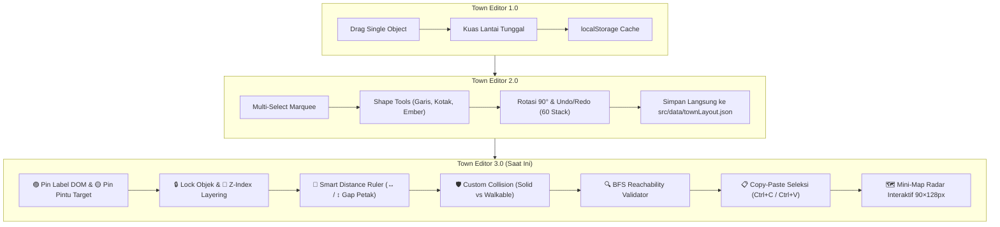

# 🗺️ Dokumentasi Komprehensif: Sistem Town Editor 3.0 (2D Porto)

Dokumen ini memuat catatan arsitektur, spesifikasi teknis, alur data, komponen antarmuka, daftar pintasan keyboard (*hotkeys*), serta panduan fungsional lengkap untuk **Town Editor Version 3.0** pada proyek portofolio interaktif 2D Pokémon.

---

## 📌 Daftar Isi
1. [Ringkasan & Evolusi Fitur (v1.0 ➔ v2.0 ➔ v3.0)](#1-ringkasan--evolusi-fitur)
2. [Peta Arsitektur & Alur Penyimpanan Terpadu](#2-peta-arsitektur--alur-penyimpanan-terpadu)
3. [Model Data & Tipe (TypeScript)](#3-model-data--tipe-typescript)
4. [Fitur Unggulan Town Editor 3.0](#4-fitur-unggulan-town-editor-30)
   * 4.1. [Sub-Pins Interaktif (🟣 Pin Label DOM & 🟡 Pin Pintu Target)](#41-sub-pins-interaktif)
   * 4.2. [Penguncian Objek (🔒 Lock / Unlock & Shortcut K)](#42-penguncian-objek)
   * 4.3. [Pengaturan Kedalaman Layer Z-Index (`[` / `]`)](#43-pengaturan-kedalaman-layer-z-index)
   * 4.4. [Penggaris Pintar Jarak Antar Objek (Smart Distance Ruler)](#44-penggaris-pintar-jarak-antar-objek)
   * 4.5. [Pengecatan Tabrakan Kustom (Solid & Walkable Override)](#45-pengecatan-tabrakan-kustom)
   * 4.6. [Validator Aksesibilitas Jalur Otomatis (BFS Reachability)](#46-validator-aksesibilitas-jalur-otomatis)
   * 4.7. [Clipboard Copy-Paste Grup Seleksi (Ctrl+C / Ctrl+V)](#47-clipboard-copy-paste-grup-seleksi)
   * 4.8. [Widget Radar Mini-Map Interaktif](#48-widget-radar-mini-map-interaktif)
5. [Katalog Objek & Template Spawner](#5-katalog-objek--template-spawner)
6. [Sistem Kuas & Palet Lantai](#6-sistem-kuas--palet-lantai)
7. [Daftar Lengkap Pintasan Keyboard (Hotkeys)](#7-daftar-lengkap-pintasan-keyboard-hotkeys)
8. [Verifikasi Kualitas & Integritas Build](#8-verifikasi-kualitas--integritas-build)

---

## 1. Ringkasan & Evolusi Fitur

**Town Editor** adalah modul *in-browser visual editor* yang berjalan langsung di atas kanvas grafis HTML5 2D Town Engine. Fitur ini dirancang agar pemilik situs dapat mendesain kota, mengatur gedung, pepohonan, lampu, semak, dekorasi, NPC, dan ubin lantai tanpa perlu mengubah koordinat mentah di dalam kode program secara manual.



---

## 2. Peta Arsitektur & Alur Penyimpanan Terpadu

Semua konfigurasi kota kini terpusat dan tersimpan secara kanonikal di berkas JSON:
`src/data/townLayout.json`.

| Berkas | Lokasi | Peran & Fungsionalitas |
| :--- | :--- | :--- |
| **`townLayout.json`** | `src/data/townLayout.json` | Sumber data *single source of truth*. Memuat seluruh koordinat gedung, prop, NPC, papan penunjuk arah, pin pintu, dan tile overrides. |
| **`townConfig.ts`** | `src/engine/townConfig.ts` | State manager *Singleton* `townConfig`. Mengelola mutasi objek, undo/redo stack (60 langkah), toggle lock, z-index, duplikasi, dan persistensi API (`/api/save-town-layout`). |
| **`townEditor.ts`** | `src/engine/townEditor.ts` | Controller editor interaktif (`TownEditor`). Menangani input mouse/keyboard, sub-pin dragging, smart distance ruler, BFS validator, copy-paste clipboard, dan kanvas mini-map. |
| **`townBackground.ts`** | `src/engine/townBackground.ts` | Render procedural grafis kota (rumput, jalan batu, lab pavers, dev pavers, air, semak, pagar, serta rumput liar Pokémon). |
| **`TownEngine.ts`** | `src/engine/TownEngine.ts` | Loop permainan utama. Menghubungkan input canvas, mengecek dynamic door triggers, menangani dialog NPC kustom, dan sinkronisasi posisi pin label DOM. |
| **`TownCanvas.astro`** | `src/components/TownCanvas.astro` | Template Astro/HTML: Toolbar editor, palette ubin, dropdown pemilih objek, modal spawner, radar mini-map, dan toast notification. |
| **`global.css`** | `src/styles/global.css` | Styling UI bertema cyber/retro glassmorphism untuk toolbar, tombol layer/lock, validator, dan widget radar mini-map. |

---

## 3. Model Data & Tipe (TypeScript)

### A. Kontrak `BuildingLayout`
```typescript
export interface BuildingLayout {
  id: string;                                // ID unik entitas (contoh: 'dev', 'home', 'twin', 'tree_k8s2')
  name: string;                              // Nama yang dapat dibaca manusia
  x: number;                                 // Posisi petak X (0 .. 44)
  y: number;                                 // Posisi petak Y (0 .. 63)
  w: number;                                 // Lebar petak
  h: number;                                 // Tinggi petak
  kind?: 'building' | 'object' | 'lamp' | 'tree' | 'bush' | 'bench' | 'flowerbed' | 'npc' | 'sign';
  subType?: string;                          // Sub-tipe visual (contoh: 'tree_sakura', 'vending', 'statue')
  orientation?: 'N' | 'E' | 'S' | 'W';       // Orientasi rotasi objek
  labelX?: number;                           // 🟣 Posisi jangkar pin label teks DOM (petak)
  labelY?: number;                           // 🟣 Posisi jangkar pin label teks DOM (petak)
  doorX?: number;                            // 🟡 Posisi petak pemicu pintu masuk / walkTo target
  doorY?: number;                            // 🟡 Posisi petak pemicu pintu masuk / walkTo target
  locked?: boolean;                          // 🔒 Kunci objek (mencegah geser/hapus tidak sengaja)
  zIndex?: number;                           // 🥞 Kedalaman urutan render layer
  dialogue?: string;                         // Teks percakapan interaktif (untuk NPC & papan tanda)
  link?: string;                             // URL navigasi / link rute saat diajak berinteraksi
  hidden?: boolean;                          // Soft-delete marker untuk riwayat Undo/Redo
}
```

### B. Kontrak `TileTypeKey`
```typescript
export type TileTypeKey =
  | 'grass'              // Rumput hijau kota
  | 'cobble'             // Jalan setapak batu cobblestone
  | 'lab_paver'          // Lantai paving modern kampus riset
  | 'dev_paver'          // Lantai megah marmer Dev Center
  | 'water'              // Air / perairan pantai
  | 'hedge'              // Semak hijau boxwood (Solid)
  | 'fence'              // Pagar besi tempa (Solid)
  | 'tall_grass'         // 🌾 Rumput liar tempat perjumpaan Critterdex
  | 'solid_override'     // 🛑 Tembok tabrakan transparan kustom (Tidak bisa dilewati)
  | 'walkable_override'; // 🟢 Lantai bebas tabrakan kustom (Bisa dilewati)
```

---

## 4. Fitur Unggulan Town Editor 3.0

### 4.1. Sub-Pins Interaktif
Ketika sebuah gedung atau landmark dipilih, editor memunculkan dua pegangan (*handle*) khusus pada kanvas:
* **🟣 Pin Label DOM (`labelX`, `labelY`)**: Pegangan berbentuk lingkaran ungu dengan garis putus-putus ke bagian atas gedung. Menyeret pin ini langsung memindahkan badge label teks HTML secara *real-time*.
* **🟡 Pin Pintu Target (`doorX`, `doorY`)**: Pegangan berbentuk lingkaran emas/kuning dengan garis putus-putus ke alas gedung. Menyeret pin ini menentukan petak tempat pemain melangkah masuk (*door trigger*) atau tujuan navigasi otomatis (*walkTo target*).
* Saat gedung digeser, kedua pin secara otomatis ikut berpindah sebesar delta `(dx, dy)`.

### 4.2. Penguncian Objek (`🔒 Lock` / Shortcut `K`)
* Tombol **🔒 Kunci** di toolbar atau shortcut **K** mengunci objek terpilih.
* Objek yang terkunci menampilkan lencana `🔒` merah di sudut kanan atas pada kanvas.
* Objek terkunci **diabaikan** oleh *click-drag*, *marquee selection*, dan tombol *Delete*, mencegah perubahan yang tidak disengaja.

### 4.3. Pengaturan Kedalaman Layer Z-Index (`[` / `]`)
* Tombol **`[` (Mundur)** menurunkan `zIndex` sebesar 1.
* Tombol **`]` (Maju)** menaikkan `zIndex` sebesar 1.
* Memungkinkan pengaturan urutan visual pohon yang menimpa bangku atau semak yang berada di depan dinding gedung.

### 4.4. Penggaris Pintar Jarak Antar Objek (Smart Distance Ruler)
* Ketika menyeret gedung atau prop, editor menghitung jarak petak (*tile gap*) antara objek yang sedang diseret dengan bangunan/objek terdekat di sekelilingnya sepanjang sumbu horizontal dan vertikal.
* Pada garis bantu cyan muncul lencana penggaris dengan jarak presisi, misalnya: `↔ 3 petak` atau `↕ 2 petak`.

### 4.5. Pengecatan Tabrakan Kustom (Solid & Walkable Override)
* Mengaktifkan alat **Inspektur Tabrakan (`C`)** memungkinkan klik atau kuas pada petak mana pun:
  * Petak dapat diubah menjadi **🛑 Solid Override** (membuat area yang sebelumnya tembus menjadi bertabrakan/tertutup).
  * Petak dapat diubah menjadi **🟢 Walkable Override** (membuat area yang sebelumnya terhalang menjadi bebas dilewati).

### 4.6. Validator Aksesibilitas Jalur Otomatis (BFS Reachability)
* Tombol **🔍 Cek Jalur** (`#btn-editor-validate`) menjalankan algoritma *Breadth-First Search* (BFS) dari titik *spawn* awal pemain ke seluruh pintu bangunan dan posisi interaksi NPC.
* Jika ada pintu atau NPC yang terblokir oleh pagar, semak, atau gedung lain, editor menampilkan:
  1. Efek lingkaran berdenyut merah (*pulsing red ring*) pada titik yang terisolasi.
  2. Lencana peringatan `⚠️ [Nama Objek]`.
  3. Toast daftar lokasi yang terhalang.
* Jika seluruh jalur aman, muncul notifikasi: `"✅ Semua gedung & NPC dapat dijangkau dari titik awal!"`.

### 4.7. Clipboard Copy-Paste Grup Seleksi (`Ctrl+C` / `Ctrl+V`)
* **`Ctrl+C`**: Menyalin seluruh objek yang sedang dipilih (baik tunggal maupun multi-seleksi) ke dalam clipboard editor dengan mempertahankan jarak relatif antar-objek.
* **`Ctrl+V`**: Menempelkan salinan objek tepat di posisi petak kursor mouse saat ini, menghasilkan objek baru dengan ID unik secara otomatis.

### 4.8. Widget Radar Mini-Map Interaktif
* Kanvas mini-map berukuran **90 × 128 px** (skala 2:1 presisi terhadap peta 45 × 64 petak) terletak di pojok kanan bawah.
* Menampilkan warna topografi tanah, footprint bangunan (oranye/cokelat), titik NPC (kuning), dan kotak persegi putih transparan yang menunjukkan sudut pandang kamera saat ini (*viewport*).
* Mengklik atau menyeret kursor di dalam mini-map akan langsung menggeser kamera kota ke koordinat tersebut (*one-click pan navigation*).

---

## 5. Katalog Objek & Template Spawner

Pengguna dapat memunculkan objek instan melalui tombol **➕ Tambah Objek** di toolbar:

| Kategori | Template | Ukuran | Ikon | Kegunaan |
| :--- | :--- | :---: | :---: | :--- |
| **Foliage & Alam** | Pohon Hijau Kota | 2×2 | 🌳 | Pohon peneduh rindang khas kota Pokémon |
| | Pohon Sakura Pink | 2×2 | 🌸 | Pohon bunga sakura mekar nan anggun |
| | Semak Hias Boxwood | 1×1 | 🌿 | Semak pangkas pembatas taman |
| | Kotak Bunga Asri | 2×2 | 🌺 | Taman bunga warna-warni |
| | Pot Berry Tanaman | 1×1 | 🫐 | Pot keramik buah berry langka |
| **Perabot & Lampu** | Lampu Jalan Klasik | 1×2 | 💡 | Lampu lentera hangat suasana malam |
| | Bangku Taman Kayu | 2×1 | 🪑 | Bangku santai di pinggir jalan |
| **Fasilitas & Dekorasi** | Mesin Minuman Vending | 1×2 | 🥤 | Mesin minuman otomatis retro |
| | Monumen Patung Pahlawan | 1×1 | 🗿 | Monumen perunggu bersejarah |
| | Teleskop Pengamat Laut | 2×2 | 🔭 | Teleskop observasi pemandangan |
| | Api Unggun Berkemah | 2×2 | 🔥 | Api unggun batu tepi pantai |
| | Tenda Pos Ranger | 3×3 | ⛺ | Tenda kanvas kemah pos ekspedisi |
| | Papan Petunjuk Jalan | 1×1 | 🪧 | Papan info kota dengan dialog interaktif |
| | Karakter Warga Kota | 1×1 | 🚶 | Karakter trainer/NPC interaktif baru |

---

## 6. Sistem Kuas & Palet Lantai

Editor menyediakan 10 ragam jenis ubin yang dapat dilukis bebas:

```
[1×1] [2×2] [3×3] ── Kuas
🪨 Jalan Batu   🏢 Paving Lab    🏛️ Lantai Megah   🌿 Rumput Hijau   🌾 Rumput Liar
🌳 Semak Hijau  🚧 Pagar Besi    🌊 Air / Laut     🛑 Tembok Solid   🟢 Bebas Lewat
```

* **🌾 Rumput Liar (`tall_grass`)**: Terintegrasi langsung dengan mesin game; pemain yang melangkah di atasnya memicu rustle animasi rumput dan berpeluang memicu encounter Critterdex!
* **Alat Garis (`L`)**: Menghubungkan titik A ke B secara lurus menggunakan algoritma Bresenham.
* **Alat Kotak (`R`)**: Memblok area persegi panjang sekaligus.
* **Alat Ember (`B`)**: *Flood fill* mewarnai seluruh ubin sejenis yang terhubung (dibatasi 500 petak aman).
* **Pipet (`I` / `Alt+Klik`)**: Menyalin jenis ubin atau memilih objek langsung di bawah kursor.

---

## 7. Daftar Lengkap Pintasan Keyboard (Hotkeys)

| Tombol Pintasan | Fungsi | Keterangan |
| :--- | :--- | :--- |
| **`E`** | Toggle Town Editor | Membuka / menutup jendela editor kota |
| **`V`** atau **`M`** | Alat Pilih & Geser | Mengaktifkan kursor seleksi objek & marquee drag |
| **`K`** | Kunci / Buka Kunci | Mengunci objek terpilih agar tidak bergeser/terhapus |
| **`[`** | Layer Down | Memundurkan urutan z-index layer objek terpilih |
| **`]`** | Layer Up | Memajukan urutan z-index layer objek terpilih |
| **`Ctrl + C`** | Salin Seleksi | Menyimpan grup objek terpilih ke clipboard |
| **`Ctrl + V`** | Tempel Seleksi | Menempelkan objek di posisi petak mouse |
| **`Ctrl + D`** | Duplikasi Cepat | Menduplikasi objek terpilih tepat di sebelahnya |
| **`Ctrl + Z`** | Undo | Membatalkan aksi terakhir (hingga 60 riwayat) |
| **`Ctrl + Y`** / **`Ctrl+Shift+Z`** | Redo | Mengulangi kembali aksi yang dibatalkan |
| **`Ctrl + S`** | Simpan Permanen | Menyimpan langsung ke `src/data/townLayout.json` |
| **`R`** | Putar 90° / Kotak | Memutar objek terpilih, atau mengaktifkan alat kotak jika kosong |
| **`L`** | Alat Garis | Menarik garis lurus jalan atau semak |
| **`B`** | Alat Ember | Melakukan *flood fill* pada area ubin yang terhubung |
| **`I`** | Pipet Warna | Menyalin jenis ubin atau memilih objek |
| **`C`** | Inspektur Tabrakan | Menampilkan overlay tabrakan & mengecat batas solid |
| **`P`** | Mode Playtest | Langsung mencoba jalan kaki & tabrakan di tempat |
| **`G`** | Toggle Grid | Menampilkan / menyembunyikan garis petak 16px |
| **`X`** | Alat Hapus Objek | Mengaktifkan kursor penghapus objek (klik langsung objek untuk menghapus) |
| **`Delete`** / **`Backspace`** | Hapus Objek Terpilih | Menghapus objek terpilih (kecuali yang terkunci) |
| **`Panah (▲▼◀▶)`** | Nudge Objek | Menggeser objek terpilih sejauh 1 petak per ketukan |
| **`Alt + Klik`** | Pipet Cepat | Menyalin jenis ubin di bawah kursor |
| **`Alt + Drag`** | Klon Cepat | Mengkloning dan langsung menggeser objek |
| **`Shift + Drag`** | Pan Kamera | Menggeser kamera peta dengan cepat |
| **`ESC`** | Lepas Seleksi | Membatalkan pilihan objek yang aktif |

---

## 8. Verifikasi Kualitas & Integritas Build

Setiap pembaruan pada modul Town Editor diuji secara ketat menggunakan alat analisis statis dan build produksi:

```bash
# 1. Typecheck & Diagnostik Linting
npx astro check
# Hasil: 0 errors, 0 warnings

# 2. Kompilasi Produksi SSG & Validasi Asset
npm run build
# Hasil: 8 routes built in ~2.1s (0 errors)
```

Semua komponen, animasi grafis, interaksi sub-pins, radar mini-map, dan sistem persistensi berjalan dengan stabilitas tinggi dan zero runtime exceptions.

