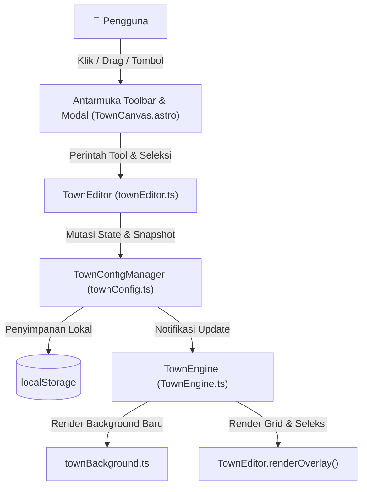

# 🗺️ Dokumentasi Komprehensif: Sistem Town Editor 2D Porto

Dokumen ini memuat catatan arsitektur, spesifikasi teknis, alur data, komponen antarmuka, daftar hotkey, serta panduan pengembangan lebih lanjut (*future roadmap*) untuk fitur **Interactive Town Editor** pada proyek portofolio 2D bertema Pokémon.

---

## 📌 Daftar Isi
1. [Ringkasan & Tujuan Fitur](#1-ringkasan--tujuan-fitur)
2. [Peta Arsitektur & Relasi File](#2-peta-arsitektur--relasi-file)
3. [Model Data & Tipe (TypeScript)](#3-model-data--tipe-typescript)
4. [Katalog Objek & Template Spawnable](#4-katalog-objek--template-spawnable)
5. [Sistem Kuas Lantai (Tile Brushes)](#5-sistem-kuas-lantai-tile-brushes)
6. [Mekanisme Interaksi & Kontrol](#6-mekanisme-interaksi--kontrol)
7. [Sistem Riwayat (Undo / Redo Stack)](#7-sistem-riwayat-undo--redo-stack)
8. [Pipeline Render Grafis Canvas](#8-pipeline-render-grafis-canvas)
9. [Komponen Antarmuka Pengguna (UI Toolbar & Modals)](#9-komponen-antarmuka-pengguna-ui-toolbar--modals)
10. [Daftar Lengkap Pintasan Keyboard (Hotkeys)](#10-daftar-lengkap-pintasan-keyboard-hotkeys)
11. [Sistem Penyimpanan & Ekspor Data](#11-sistem-penyimpanan--ekspor-data)
12. [Rekomendasi & Roadmap Pengembangan Mendatang](#12-rekomendasi--roadmap-pengembangan-mendatang)

---

## 1. Ringkasan & Tujuan Fitur

**Town Editor** adalah modul penyunting peta interaktif berbasis peramban (*in-browser visual editor*) yang berjalan langsung di atas kanvas grafis HTML5 2D Town Engine. Fitur ini memungkinkan pengguna untuk:
* Mengatur tata letak bangunan, dekorasi luar, pohon, semak, lampu jalan, dan bangku secara *real-time* via *drag-and-drop*.
* Mewarnai/mengganti jenis ubin lantai (*tile overrides*) menggunakan kuas lukis langsung pada petak grid map (45 × 64 petak @ 16px/petak).
* Menambahkan objek dekorasi dan vegetasi baru ke dalam kota (*Object Spawner*).
* Menghapus objek yang tidak diinginkan dan membatalkan/mengulang perubahan (*Undo/Redo*).
* Menyimpan hasil desain ke `localStorage` peramban serta mengekspor struktur koordinat JavaScript/TypeScript untuk ditanamkan secara permanen ke kode sumber.



---

## 2. Peta Arsitektur & Relasi File

Fitur editor dibangun secara modular melintasi beberapa berkas utama di dalam `src/`:

| File | Jalur Berkas | Peran Utama |
| :--- | :--- | :--- |
| **`townConfig.ts`** | `src/engine/townConfig.ts` | State manager terpusat (*Singleton* `townConfig`). Menyimpan daftar entitas bangunan/objek, modifikasi petak lantai, stack undo/redo, katalog template, dan I/O `localStorage`. |
| **`townEditor.ts`** | `src/engine/townEditor.ts` | Kontroler logika editor (`TownEditor`). Menangani kalkulasi koordinat layar ke petak (`screenToTile`), penanganan input mouse/keyboard, status kursor, dan *canvas overlay rendering* (grid petak, kotak seleksi, tooltip koordinat). |
| **`townBackground.ts`** | `src/engine/townBackground.ts` | Mesin grafis pixel-art procedural. Berisi fungsi-fungsi gambar bangunan, tanaman, lampu, semak, dan ubin kustom yang membaca data dinamis dari `townConfig`. |
| **`TownEngine.ts`** | `src/engine/TownEngine.ts` | Loop permainan utama. Menghubungkan input canvas ke `townEditor`, memanggil `renderOverlay` di atas layer peta, mengatur kamera/zoom, dan memvalidasi collision petak kustom. |
| **`TownCanvas.astro`** | `src/components/TownCanvas.astro` | Komponen Astro/HTML yang merender toolbar mengambang, palette kuas lantai, dropdown pemilih objek, modal spawner objek, modal ekspor kode, dan toast pemberitahuan. |
| **`global.css`** | `src/styles/global.css` | Lembar gaya bertema Pokémon futuristik/retro (glassmorphism `#0d1117`, aksen cyan/sky/gold/emerald, tombol pixel mini, dan modal responsif). |

---

## 3. Model Data & Tipe (TypeScript)

Semua kontrak tipe data inti didefinisikan dalam `src/engine/townConfig.ts`:

### A. `BuildingLayout` (Entitas Objek & Bangunan)
```typescript
export interface BuildingLayout {
  id: string;        // ID unik (contoh: 'dev', 'lamp_cy_nw', 'tree_173000000')
  name: string;      // Label yang dapat dibaca manusia (contoh: 'Dev Center', 'Pohon Hijau Kota')
  x: number;         // Koordinat petak X (0 .. 44)
  y: number;         // Koordinat petak Y (0 .. 63)
  w: number;         // Lebar dalam petak (tile unit)
  h: number;         // Tinggi dalam petak (tile unit)
  kind?: 'building' | 'object' | 'lamp' | 'tree' | 'bush' | 'bench' | 'flowerbed';
  subType?: string;  // Sub-tipe visual (contoh: 'tree_town', 'tree_sakura', 'hedge', 'vending')
  labelX?: number;   // Koordinat relatif pin label teks DOM
  labelY?: number;   // Koordinat relatif pin label teks DOM
  hidden?: boolean;  // Menandai objek yang dihapus (soft-delete untuk undo)
}
```

### B. `TileTypeKey` (Kunci Jenis Lantai)
```typescript
export type TileTypeKey = 'grass' | 'cobble' | 'lab_paver' | 'dev_paver' | 'water' | 'hedge' | 'fence';
```

### C. `SpawnableTemplate` (Definisi Template Katalog Objek)
```typescript
export interface SpawnableTemplate {
  id: string;        // ID template (contoh: 'tpl_tree_town')
  name: string;      // Nama tampilan objek
  icon: string;      // Ikon emoji
  category: 'Foliage & Alam' | 'Perabot & Lampu' | 'Fasilitas & Dekorasi';
  w: number;         // Lebar default
  h: number;         // Tinggi default
  kind: 'tree' | 'bush' | 'bench' | 'lamp' | 'flowerbed' | 'object';
  subType?: string;  // Sub-tipe render
  desc: string;      // Penjelasan singkat fungsi objek
}
```

### D. `TownStateSnapshot` (Rekaman Riwayat Undo/Redo)
```typescript
export interface TownStateSnapshot {
  buildings: BuildingLayout[];
  tiles: [string, TileTypeKey][]; // Format kunci: "x,y"
}
```

---

## 4. Katalog Objek & Template Spawnable

Editor dilengkapi dengan 12 template bawaan yang dapat dipasang berkali-kali ke peta melalui modal **➕ Tambah Objek**:

| Kategori | Template ID | Nama Objek | Ikon | Dimensi | Kind | SubType | Deskripsi |
| :--- | :--- | :--- | :---: | :---: | :---: | :---: | :--- |
| **Foliage & Alam** | `tpl_tree_town` | Pohon Hijau Kota | 🌳 | 2×2 | `tree` | `tree_town` | Pohon peneduh rindang khas Pokémon Gen 4/5 |
| **Foliage & Alam** | `tpl_tree_sakura` | Pohon Sakura Pink | 🌸 | 2×2 | `tree` | `tree_sakura` | Pohon bunga sakura mekar nan anggun |
| **Foliage & Alam** | `tpl_bush` | Semak Hias Boxwood | 🌿 | 1×1 | `bush` | `hedge` | Semak pangkas rapi pembatas taman |
| **Foliage & Alam** | `tpl_flowerbed` | Kotak Bunga Asri | 🌺 | 2×2 | `flowerbed` | `flowerbed` | Taman bunga warna-warni yang asri |
| **Foliage & Alam** | `tpl_berry_pot` | Pot Berry Tanaman | 🫐 | 1×1 | `object` | `berry_pot` | Pot keramik buah berry langka |
| **Perabot & Lampu** | `tpl_lamp` | Lampu Jalan Klasik | 💡 | 1×2 | `lamp` | `lamp` | Lampu lentera besi hangat temaram malam |
| **Perabot & Lampu** | `tpl_bench` | Bangku Taman Kayu | 🪑 | 2×1 | `bench` | `bench` | Bangku kayu santai untuk istirahat |
| **Fasilitas & Dekorasi**| `tpl_vending` | Mesin Minuman Vending | 🥤 | 1×2 | `object` | `vending` | Mesin otomatis Fresh Water & Soda Pop |
| **Fasilitas & Dekorasi**| `tpl_statue` | Patung Pahlawan | 🗿 | 1×1 | `object` | `statue` | Monumen perunggu patung bersejarah |
| **Fasilitas & Dekorasi**| `tpl_telescope` | Teleskop Pengamat | 🔭 | 2×2 | `object` | `telescope` | Teleskop lookout pemandangan laut lepas |
| **Fasilitas & Dekorasi**| `tpl_campfire` | Api Unggun Berkemah | 🔥 | 2×2 | `object` | `campfire` | Api unggun dengan batu pelindung |
| **Fasilitas & Dekorasi**| `tpl_tent` | Tenda Pos Ranger | ⛺ | 3×3 | `object` | `tent` | Tenda kanvas ekspedisi penjelajah |

---

## 5. Sistem Kuas Lantai (Tile Brushes)

Palette kuas lantai (`#town-editor-palette`) menyediakan 7 jenis ubin yang langsung menimpa ubin dasar:

```
[🪨 Jalan Batu]  [🏢 Paving Lab]  [🏛️ Lantai Megah]  [🌿 Rumput]  [🌳 Semak]  [🚧 Pagar]  [🌊 Air]
```

1. **`cobble` (Jalan Batu)**: Jalan paving batu alam kota dengan tekstur grid andesit.
2. **`lab_paver` (Paving Lab)**: Ubin beton modern futuristik dengan lis teknologi.
3. **`dev_paver` (Lantai Megah)**: Marmer klasik sandstone untuk kawasan istana/manor.
4. **`grass` (Rumput Hijau)**: Menghapus jalan dan mengembalikan tanah menjadi padang rumput hijau.
5. **`hedge` (Semak Boxwood)**: Melukis blok semak lebat hijau yang berfungsi sebagai dinding pembatas alami.
6. **`fence` (Pagar Besi)**: Melukis pagar besi tempa hitam bergaya Sinnoh.
7. **`water` (Air / Laut)**: Melukis petak perairan laut berombak (otomatis non-walkable).

> [!NOTE]
> Ubin kustom disimpan dalam Map `tileOverrides` dengan format kunci string `"x,y"`. Mesin game (`TownEngine.ts`) langsung mendeteksi ubin jenis `water`, `hedge`, dan `fence` sebagai penghalang tabrakan (*non-walkable*).

---

## 6. Mekanisme Interaksi & Kontrol

### A. Algoritma Prioritas Seleksi (*Smart Selection Hierarchy*)
Peta kota memiliki berbagai ukuran objek: mulai dari gedung raksasa 12×11 petak hingga lampu 1×2 dan semak 1×1 petak.
Agar klik pengguna tidak selalu "terhalang" gedung besar di belakang objek kecil:
```typescript
// Mengurutkan objek berdasarkan luas area petak (w * h) terkecil ke terbesar:
const buildings = townConfig.getBuildings().slice().sort((a, b) => (a.w * a.h) - (b.w * b.h));
```
Objek berukuran kecil (lampu, pohon, bangku, semak) akan diperiksa dan dipilih terlebih dahulu jika titik klik berada di dalamnya.

### B. Indikator Visual Kanvas (*Canvas Overlays*)
Ketika mode editor aktif, sistem merender layer visual di atas dunia game:
* **Garis Grid Petak**: Garis bantu putus-putus (`showGrid: true`) membatasi petak 16×16 piksel di seluruh luas 45×64 petak.
* **Petak Sorotan Kursor (*Hover Highlight*)**: Menyorot petak aktif di bawah kursor (berwarna biru muda untuk kuas/move, merah untuk hapus lantai).
* **Badge Koordinat Kursor**: Menampilkan `[X, Y]` mengambang di samping kursor.
* **Objek Terpilih**: Bingkai emas menyala beranimasi putus-putus, dilengkapi 4 kotak sudut (*corner handles*) dan badge informasi `📍 [Nama Objek]: (X, Y)`.
* **Objek Tidak Aktif**: Garis tipis halus untuk gedung, atau titik sudut lembut untuk dekorasi kecil agar pandangan mata tidak penuh sesak.

### C. Kamera & Navigasi Layar
* **Pan Kamera Editor**: Tahan tombol mouse tengah, klik kanan, atau tahan tombol `Shift + Klik Kiri` lalu geser mouse untuk menggeser pandangan kamera (*pan camera*).
* **Zoom Layar**: Putar roda mouse (*Mouse Wheel*) untuk memperbesar (*zoom-in*) atau memperkecil (*zoom-out*).
* **Auto-Focus Kamera**: Memilih objek dari dropdown pemilih secara otomatis mengarahkan fokus kamera ke titik tengah objek tersebut.

---

## 7. Sistem Riwayat (Undo / Redo Stack)

Sistem riwayat dirancang tanpa celah untuk mencegah kesalahan modifikasi yang tidak disengaja:
* **Ukuran Maksimal Stack**: Menyimpan hingga 60 langkah snapshot perubahan terakhir (`maxHistory = 60`).
* **Aksi yang Direkam Snapshot**:
  1. Mulai seret gedung/objek (`handleMouseDown` -> `handleMouseUp`).
  2. Goresan kuas lantai atau penghapusan lantai.
  3. Pemasangan objek baru melalui Spawner (`spawnObject`).
  4. Penghapusan objek (`deleteBuilding`).
  5. Pergeseran posisi menggunakan tombol panah keyboard (*Arrow Nudge*).
  6. Tombol reset tata letak (`resetToDefaults`).
* **Shortcut Global**: `Ctrl+Z` (Undo), `Ctrl+Y` atau `Ctrl+Shift+Z` (Redo).
* **Indikator Tombol**: Tombol `↩️ Undo` dan `↪️ Redo` otomatis mati (*disabled*) bila tidak ada riwayat yang tersisa.

---

## 8. Pipeline Render Grafis Canvas

Render latar belakang peta dieksekusi secara berlapis di dalam `src/engine/townBackground.ts` melalui fungsi utama `createTownBackgroundCanvas(map)`:

```
1. Dasar Topografi (Base Terrain & Ocean Water)
   ↓
2. Hutan Perbatasan & Garis Pantai (Lush Forest & Sea Wall)
   ↓
3. Jalanan, Plaza Batu & Arena Latihan (Roads, Plazas, Battle Arena)
   ↓
4. Dedaunan, Pagar & Semak Dinamis (Foliage, Fences, Configured Bushes & Flowerbeds)
   ↓
5. Pepohonan Kota Dinamis (renderManicuredTownTrees: Town Trees & Sakura)
   ↓
6. Lapisan Ubin Kustom Kuas (renderCustomTileOverrides)
   ↓
7. Gedung-Gedung Arsitektur (Dev Center, Lab, Pokecenter, Mart, Arcade, dll.)
   ↓
8. Aksesori & Fasilitas Luar (Fountain, Basin, Benches, Lamps, Vending, Statue, Campfire, dll.)
```

Semua komponen membaca status `townConfig.getBuildings()` dan mengecualikan objek dengan tanda `b.hidden === true`.

---

## 9. Komponen Antarmuka Pengguna (UI Toolbar & Modals)

Elemen antarmuka dimuat di dalam berkas `src/components/TownCanvas.astro`:

```
┌────────────────────────────────────────────────────────────────────────────────────────┐
│ 🎮 Mode Editor Kota (Aktif)                           [🔼 Sembunyi] [✖️ Tutup]        │
├────────────────────────────────────────────────────────────────────────────────────────┤
│ [🖐️ Geser] [➕ Tambah] [🖌️ Kuas] [🧹 Hapus] [📐 Grid] │ [🎯 Pilih Objek... ▾] [✖] [🗑️]│
│ [↩️ Undo] [↪️ Redo] │ [💾 Simpan] [📋 Salin Kode] [🔄 Reset] [⛶ Fullscreen] [✖️ Tutup] │
├────────────────────────────────────────────────────────────────────────────────────────┤
│ PILIH LANTAI: [🪨 Jalan Batu] [🏢 Paving Lab] [🏛️ Lantai Megah] [🌿 Rumput] ...       │
└────────────────────────────────────────────────────────────────────────────────────────┘
```

### Elemen-Elemen Kunci UI:
* `#town-editor-toolbar`: Kotak toolbar mengambang semi-transparan di bagian atas layar.
* `#tool-btn-move`: Mode menggeser gedung dan objek dengan klik-seret kursor.
* `#tool-btn-spawn`: Tombol untuk membuka dialog katalog penambahan objek baru.
* `#tool-btn-brush`: Mode mewarnai petak lantai dengan jenis ubin yang aktif.
* `#tool-btn-erase`: Mode menghapus lantai kustom dan mengembalikan ke ubin bawaan.
* `#tool-btn-grid`: Menyalakan/mematikan tampilan garis grid petak di peta.
* `#town-object-picker`: Dropdown pemilih objek terkelompok (Gedung, Pohon, Semak, Lampu, Bangku, Fasilitas).
* `#btn-editor-deselect`: Tombol lepas seleksi (`Escape`).
* `#btn-editor-delete`: Tombol hapus objek terpilih (`Delete` / `Backspace`).
* `#btn-editor-fullscreen`: Mengalihkan tampilan peta menjadi satu layar penuh.
* `#town-editor-spawn-modal`: Modal dialog katalog grid objek spawnable lengkap dengan preview emoji.
* `#town-editor-export-modal`: Modal dialog kode ekspor JavaScript/TypeScript untuk ditanamkan ke berkas proyek.
* `#town-editor-toast`: Pop-up notifikasi melayang di bagian bawah untuk umpan balik instan.

---

## 10. Daftar Lengkap Pintasan Keyboard (Hotkeys)

| Pintasan Keyboard | Konteks | Aksi yang Dijalankan |
| :--- | :--- | :--- |
| **`E`** | Layar Peta | Membuka / Menutup Editor Kota (*Toggle Editor*). |
| **`F`** | Mode Editor | Mengaktifkan / Menonaktifkan Mode Fullscreen Layar Penuh. |
| **`G`** | Mode Editor | Menyalakan / Mematikan Garis Kisi Petak (*Toggle Grid*). |
| **`Ctrl + Z`** / **`Cmd + Z`** | Mode Editor | Membatalkan perubahan terakhir (*Undo*). |
| **`Ctrl + Y`** / **`Ctrl + Shift + Z`** | Mode Editor | Mengulangi perubahan yang dibatalkan (*Redo*). |
| **`Tombol Panah (↑ ↓ ← →)`** | Objek Terpilih | Menggeser posisi objek terpilih sejauh 1 petak (*Precision Nudge*). |
| **`Delete`** / **`Backspace`** | Objek Terpilih | Menghapus objek/gedung yang sedang dipilih. |
| **`Escape`** | Objek Terpilih | Melepaskan seleksi objek yang aktif. |
| **`Shift + Drag Mouse`** | Di mana saja | Menggeser pandangan kamera (*Pan Camera*). |
| **`Klik Kanan / Tengah Drag`** | Di mana saja | Menggeser pandangan kamera (*Pan Camera*). |
| **`Scroll Roda Mouse`** | Di mana saja | Memperbesar / memperkecil tampilan peta (*Zoom In / Out*). |

---

## 11. Sistem Penyimpanan & Ekspor Data

### A. Format Penyimpanan Lokal (`localStorage`)
Setiap kali ada perubahan posisi objek, pembuatan objek, penghapusan, atau pengecatan ubin, data disimpan secara otomatis ke dalam:
* **Key Storage**: `'zulfan_town_custom_layout_v1'`
* **Struktur JSON**:
```json
{
  "buildings": [
    { "id": "dev", "name": "Dev Center", "x": 10, "y": 1, "w": 12, "h": 11, "kind": "building" },
    { "id": "tree_town_lh7k2", "name": "Pohon Hijau Kota #1", "x": 14, "y": 22, "w": 2, "h": 2, "kind": "tree", "subType": "tree_town" }
  ],
  "tiles": [
    ["15,20", "cobble"],
    ["16,20", "cobble"]
  ]
}
```

### B. Fitur Salin Kode / Ekspor Permanen
Menekan tombol **📋 Salin Kode** menghasilkan format data siap tempel untuk file `src/engine/map.ts` atau `townBackground.ts`:
```typescript
// === HASIL DESAIN TATA LETAK KOTA (TOWN EDITOR EXPORT) ===
// Salin data koordinat bangunan berikut ke map.ts / townBackground.ts:
const BUILDINGS_LAYOUT = {
  dev: { x: 10, y: 1, w: 12, h: 11, kind: 'building' }, // Dev Center
  lamp_cy_nw: { x: 12, y: 14, w: 1, h: 2, kind: 'lamp' }, // Lampu Courtyard NW
  tree_town_1: { x: 18, y: 30, w: 2, h: 2, kind: 'tree', subType: 'tree_town' }, // Pohon Hijau Kota #1
};

// Custom Tile Overrides (2 petak):
const CUSTOM_TILES = [
  { x: 15, y: 20, tile: 'cobble' },
  { x: 16, y: 20, tile: 'cobble' },
];
```

---

## 12. Dokumentasi Rilis Town Editor 2.0 (Implemented)

Sistem Town Editor telah berhasil ditingkatkan ke **Versi 2.0 (Comprehensive Power Level-Design)** dengan 4 fase peningkatan utama:

### 12.1. Fase 1: Penyimpanan Langsung ke File Sumber (Dev Disk Write)
* **Single Source of Truth (`src/data/townLayout.json`)**: Semua 84 objek default dan kustomisasi ubin tersimpan dalam satu file JSON kanonikal yang diimpor langsung oleh `townConfig.ts`.
* **Vite Dev Server Middleware (`astro.config.mjs`)**: Endpoint `POST /api/dev/save-town` menggunakan `node:fs/promises` untuk menulis langsung ke disk saat menjalankan `npm run dev`.
* **Owner-Only Guard (`TownCanvas.astro`)**: Tombol editor dan shortcut `E` hanya aktif ketika `import.meta.env.DEV === true` atau URL mengandung `?editor=1`.

### 12.2. Fase 2: Kuas Canggih & Shape Tools
* **Ukuran Kuas (`1×1`, `2×2`, `3×3`)**: Shortcut angka `1`, `2`, `3` atau tombol di palette bar dengan live hover footprint preview.
* **Garis Lurus (`L` / Line Tool)**: Algoritma Bresenham dengan live ghost preview dan commit otomatis saat mouse dilepas.
* **Kotak Fill (`R` / Rect Tool)**: Mengisi area persegi sekaligus dari titik awal ke titik akhir.
* **Ember Cat (`B` / Flood Fill)**: BFS flood fill otomatis mewarnai area petak yang bersambung (dibatasi 500 petak untuk performa tinggi).
* **Pipet Sampler (`I` / `Alt + Klik`)**: Menyalin jenis lantai atau objek langsung di bawah kursor.

### 12.3. Fase 3: Manipulasi Objek & Smart Alignment
* **Duplikasi Cepat (`Ctrl+D` / `Alt + Drag`)**: Menduplikasi pohon, lampu, semak, bangku, atau fasilitas secara instan.
* **Multi-Selection & Marquee Select (`Shift + Klik` / Drag Kotak Seleksi)**: Memilih banyak objek sekaligus untuk digeser atau dihapus bersamaan.
* **Rotasi Objek (`R`)**: Memutar objek prop 90° (`N -> E -> S -> W`). Untuk bangku taman (`bench`), dimensi `w` dan `h` ditukar otomatis dan bilah kayu dirender vertikal secara otomatis.
* **Smart Alignment Guides**: Garis panduan cyan putus-putus muncul otomatis saat pusat atau tepi objek sejajar dengan objek lain.

### 12.4. Fase 4: Inspektur Tabrakan & Instant Playtest
* **Collision Inspector (`C` / Tombol Collision)**: Overlay visual semi-transparan (Merah = Solid/Tabrakan, Hijau = Walkable/Bisa dilalui, Kuning = Pintu Masuk Bangunan, Biru = Titik Interaksi NPC).
* **Instant Playtest Mode (`P` / Tombol Playtest)**: Menyembunyikan editor toolbar/grid, menteleportasi karakter pemain langsung ke posisi kursor, dan memungkinkan pengujian fisik seketika. Tekan `P` atau `E` untuk kembali ke editor.

---

*Dokumentasi ini telah diperbarui secara resmi untuk versi Town Editor 2.0 pada proyek 2D Porto.*

